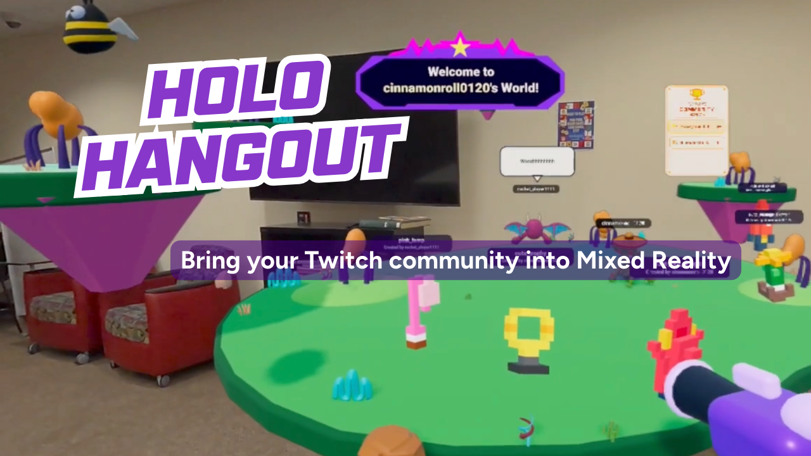

# Holo Hangout
### A New Dimension of Shared Live Experiences

<p align="center">
  
</p>

**HoloHangout** brings Twitch viewers into a VR streamer's mixed reality world as animated characters, allowing creators and their communities to interact, play, and create together in real time.

[Get Started](#quick-start) · [Download Source](https://github.com/Harpita-P/Holo-Hangout-Mixed-Reality/archive/refs/heads/main.zip) · [Quest Capture APK](release/HoloHangout-Capture.apk)

## What Can You Do?

### For Streamers
- Broadcast your shared experience live on Twitch.
- Bring your Twitch community into your mixed-reality world through chat.
- Meet, grab, and interact with viewers as animated 3D characters.
- Play the **Streamer vs. Chat** blaster challenge.
- Create together in **Community Sandbox**, where viewers' ideas become interactive 3D objects.

### For Viewers
- Join the streamer's world by typing `!join` in Twitch chat — no headset or installation needed.
- Appear as your own animated character, chat, and perform actions.
- Play alongside the streamer in interactive challenges.
- Use `!build <idea>` to suggest 3D creations that the streamer can approve and physically interact with.

## Quick Start - 4 Step Setup

### Requirements
- Windows or macOS
- Meta Quest 3 / 3S and USB data cable
- [Node.js](https://nodejs.org/) (22.19.0 recommended)
- [OBS Studio](https://obsproject.com/)
- [Android Platform Tools (ADB)](https://developer.android.com/tools/releases/platform-tools)
- [FFmpeg](https://ffmpeg.org/download.html)
- Twitch account and developer application

### 1. Install Holo Hangout

Open Terminal (macOS) or PowerShell (Windows):

```bash
git clone https://github.com/Harpita-P/Holo-Hangout-Mixed-Reality.git
cd Holo-Hangout-Mixed-Reality
npm install
npm run setup
```

Follow the [Twitch Setup](docs/TWITCH.md) and [Quest + OBS Setup](docs/QUEST-OBS.md) guides for first-time configuration.

Install the Quest Capture app once:

```bash
npm run capture:install:release
```

### 2. Launch Holo Hangout

```bash
npm run start:holohangout
```

Open the dashboard at **http://localhost:8787**.

### 3. Start Your Hangout

1. **Connect Twitch** — Authorize your Twitch account from the dashboard.
2. **Enter Your World** — Open `https://localhost:8081/` in Quest Browser and select **Enter AR**.
3. **Go Live on Twitch** — Start HoloHangout Capture and stream through OBS.
4. **Invite Your Viewers** — Ask your chat to type `!join` to enter your world!

## More Information

- [Full Setup Guide](docs/SETUP.md)
- [Twitch Setup](docs/TWITCH.md)
- [Quest Capture & OBS](docs/QUEST-OBS.md)
- [Chat Commands](docs/COMMANDS.md)
- [Community Sandbox](docs/COMMUNITY-SANDBOX.md)
- [Troubleshooting](docs/TROUBLESHOOTING.md)

## License

HoloHangout is open-source under the [MIT License](LICENSE).
